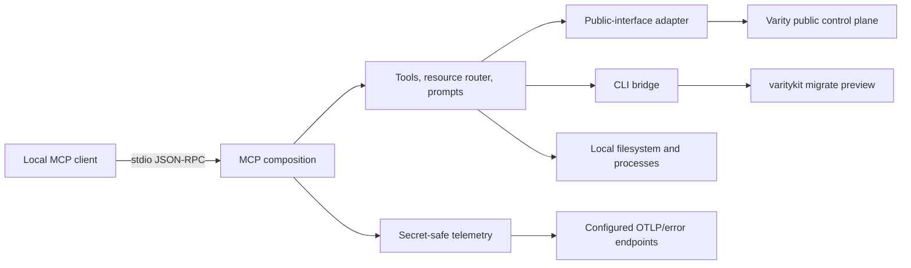

# `@varity-labs/mcp` Architecture

Status: current implementation map
Scope: stable ownership, interfaces, adapters, state, security, failures, and tests

This repository is the public stdio MCP adapter for Varity, and the server
factory and remote toolset that the hosted MCP mount (the gateway) builds on. Cross-repository
concept ownership is routed by `varity-engineering/architecture/CHANGE-IMPACT.md`;
source and tests here own the package's executable behavior. Live versions,
pricing, deployment state, and supported capability come from their executable
owners rather than copied prose.

## Ownership

This repository owns:

- the MCP tool, compatibility resource, and prompt interface presented to local
  AI coding clients;
- the server factory `createVarityServer({credentialProvider?, toolset?})`
  (package export `@varity-labs/mcp/server`) and the remote toolset, its tool
  allow-list, annotations, `instructions`, explain-only billing copy and the
  deployment card (MCP Apps) resource;
- stdio process composition and JSON-RPC channel custody;
- translation from validated MCP inputs to the deploy-key-authenticated public
  Varity interface, or (migration preview only) a local `varitykit` command;
- consistent structured success/error responses;
- secret-safe telemetry through standard OpenTelemetry exporters and optional
  Better Stack error ingestion;
- bounded local helpers for builds, dependencies, browser opening, development
  servers, migration, and repository creation.

It does not own:

- the hosted HTTP mount (route, OAuth resource-server behaviour, token
  verification, rate limits: the gateway's `routes/hosted-mcp.ts`), an OAuth
  service, or a container release;
- workload planning, hosting selection, deployment execution, route activation,
  cleanup, or remediation policy;
- durable deployment/release state, credentials, billing ledgers, profile
  catalogs, pricing policy, or copied deployment guidance;
- direct provider, static-storage, database-proxy, credential-proxy, or billing
  integrations.

## Context and call flow



Deployment-lifecycle mutations (deploy, template deploy, delete, redeploy) and
the template catalog reach the downstream control plane through the
public-interface client; only the migration preview runs `varitykit`. Local build, dependency, browser, development-server, and
repository helpers remain local adapters, as the routing table below records.
MCP output is a projection of downstream truth: process exit can prove command
acceptance, but only a durable run or owner-scoped status read can prove later
lifecycle state.

## Runtime modules and interfaces

| Module | Interface and invariant | Implementation | Verification |
|---|---|---|---|
| Entrypoint | stdio only; stdout contains JSON-RPC only; unknown/retired transport flags fail closed | `src/index.ts` | `test/runtime-version.mjs`, `test/logger-stdio-channel.mjs`, runtime matrix |
| MCP composition | `createVarityServer(options)`: `toolset: "local"` (default) is the complete stdio surface; `"remote"` is the hosted surface. Every tool callback runs in its server's call context (credential provider, transport, client identity) through `AsyncLocalStorage`, so concurrent servers in one process never share a credential | `src/server.ts` | `test/tool-annotations.mjs`, `test/remote-toolset.mjs` plus package startup tests |
| Toolsets | `local`: all 30 tools, the compatibility resource and prompts, and the stdio rules (`src/toolsets/instructions.ts`: deploy the user's folder with `varity_deploy` and its absolute `path`, then `varity_deploy_status`; on `UPLOAD_UNAVAILABLE` offer Chat and Build; sign in with `varity_login`, no key in chat; at most 512 characters, no other host named) as MCP `instructions`. `remote`: exactly 12 tools (search_docs, cost_calculator, balance, list_templates, template_info, deploy_template, deploy, deploy_status, deploy_logs, redeploy, delete_deployment, show_deployment), the deployment card resource and self-contained `instructions` (the tool order, no key in chat, Chat and Build first without a public GitHub repository; at most 512 characters, none of the stdio folder rules); no filesystem, process, credential or machine tool; `varity_deploy` takes `repo_url` or `image` only (no `path`; `files` waits for the upload interface); `varity_deploy_status` runs no server-side HTTP probe of deployment URLs (the hosted server would fetch arbitrary URLs), so remotely liveness is the served status | `src/toolsets/local.ts`, `src/toolsets/remote.ts` | `test/remote-toolset.mjs`; `npm run check:architecture` refuses a static module graph from `src/toolsets/remote.ts` reaching `node:fs`, `node:child_process`, `node:os` or the CLI bridge (`test/architecture-remote-graph.mjs`). This guards what remote tools can call; the `./server` export still loads the local modules through `src/server.ts` without registering them |
| Deployment card | `ui://varity/deployment-card.html`, `text/html;profile=mcp-app`, empty CSP origin lists; attached only to the read-only `varity_show_deployment`; shows the served price, status steps, URL and failure reason; Refresh calls `varity_show_deployment` again, Open sends only an http(s) URL to the host's `ui/open-link`; accepts messages only from its parent frame and pins the host origin from the `ui/initialize` answer; never deploys and has no billing link | `src/apps/`, `src/tools/show-deployment.ts` | `test/deployment-card.mjs` |
| Tools | Zod-validated input and shared structured responses; no provider or orchestration policy | `src/tools/` | per-adapter and regression tests under `test/` |
| Compatibility resource | `varity://deploy/reference` remains stable but routes mutable facts to live docs/tools | `src/resources/index.ts` | cleanup contract and architecture checks |
| CLI bridge | argv arrays, bounded timeouts/output, normalized environment; `varitykit` is invoked only by the migration preview | `src/utils/cli-bridge.ts` | `test/cli-bridge-env.mjs`, `test/migrate-custody.mjs` |
| Public-interface client | the one HTTP client for every Cloud read and lifecycle mutation (deploy, template catalog and deploy, delete, redeploy, env, run status, machines); the bearer comes from the current call's credential provider: stdio uses the deploy-key order `VARITY_DEPLOY_KEY`, `~/.varitykit/config.json`, `VARITY_API_KEY` (`src/utils/config.ts`, loaded lazily so the remote graph reads no file); a remote server uses only its provider, and null is `NOT_AUTHENTICATED` with no env or file fallback; `User-Agent: varity-mcp/<version> (<client>/<client version>; transport=<stdio\|streamable_http>[; dist=<slug>])` from the client's `initialize` identity, bounded to `[A-Za-z0-9._-]{1,64}` tokens, where `dist` is `VARITY_DISTRIBUTION` on stdio when it matches `^[a-z0-9-]{1,32}$` and is dropped otherwise; `source: "mcp"` on create; a per-call `Idempotency-Key` on deploy, template deploy and redeploy; bounded timeout, normalized errors; no copied pricing or lifecycle state | `src/utils/public-api.ts` | `test/public-api-client.mjs`, `test/idempotent-create.mjs`, `test/client-attribution.mjs`, `test/deploy-key-resolution.mjs`, `test/public-api-budget.mjs`, `test/lifecycle-outcomes.mjs`, `test/billing-refusals.mjs`, `test/agent-journey-contract.mjs`, status/log tests |
| Local GitHub helper | credentials come from process environment or `gh`; clean remote URL; normal non-force push | `src/tools/create-repo.ts` | cleanup contract plus Git behavior review |
| Runtime telemetry | opt-in spans/logs/metrics/errors; protected inputs and stdout excluded | `src/telemetry.ts`, `src/runtime-shutdown.ts`, `src/utils/logger.ts` | telemetry, logger, and shutdown tests |

The CLI bridge and public-interface client are separate adapters because their
callers need different downstream interfaces: the migration preview transforms
a local checkout, which no public route does. Every tool advertises a title and
all four MCP hints (readOnly, destructive, idempotent, openWorld) explicitly;
`test/tool-annotations.mjs` holds the binding table.

## Tool routing

| Behavior | Current path | Qualification |
|---|---|---|
| Deploy source/public image | MCP tool → public-interface client → `POST /api/deployments` | The source is a repo URL (explicit or the project's `origin` remote) or an image; the control plane owns build and hosting policy |
| Deploy a folder (upload, stdio only) | `varity_deploy` → `src/tools/pack.ts` → `POST /api/deployments/sources` → `PUT <upload_url>` (gateway-relative, same Bearer, `application/gzip`) → `POST /api/deployments` with `source:{type:"upload", source_id, client:"mcp"}` | Used when the folder has no `origin`, its repository is unreadable (private), or `source:"upload"` is passed, and only for an explicit `path` (never the home or root folder). The archive is one gzip member of regular files (`src/utils/source-archive.ts`), honoring every `.gitignore` plus default excludes, never following links; IF-SECRET-PATHS files stay local and are named, never read into output. The gateway and deploy-api validate again and are authoritative. Route off (404 `not_found`/`uploads_unavailable`, 405, 501) → `UPLOAD_UNAVAILABLE`: nothing uploaded, deployed or charged; the remedy leads with the Portal's Chat and Build (no GitHub), public GitHub last. A private-repo remedy offers the upload first only after this server saw an upload succeed. The key is sent only to a `/api/` upload URL |
| Deploy a folder (private copy, stdio only) | `varity_deploy` → `src/tools/pack.ts` `collectFolder` → `src/tools/deploy-private-copy.ts` → `POST /api/github/hosted-repositories {name}` → `POST /api/github/changes` (one per chunk, `Idempotency-Key` `mcp-change:<run>:<i>`) → `POST /api/deployments {repo_url, commit}` | Used once the upload route answered off on this server (a folder the upload cannot pack gets the upload's own refusal while the route is not known off). Caps checked before any call: 500 files, 5,000,000 bytes, 1,000,000 bytes per file, and estimated GitHub units (2 for the create, then 3 + base64 files per commit, packed in send order) ≤ 3 paced minute windows of 23 units (≤ 69) ("needs more saves than one folder deploy allows"), else `FOLDER_TOO_LARGE_FOR_VARITY`, whose action offers .gitignore, Chat and Build, a template or an image. A 429 with a `Retry-After` that fits the 170 s commit deadline is waited out and the same request (same `Idempotency-Key`, branch and fence) resent; otherwise the run answers busy before any commit landed, else `FOLDER_SAVE_INCOMPLETE`. Chunks of at most 50 files, 1,000,000 bytes and 20 base64 files commit serially to a new `varity/mcp-<utc>-<rand>` branch, each later one fenced by `expected_head_sha`. Create 404 or 403 `repo_authority_required` = route unavailable (`hostedRouteUnavailable`): nothing created, `UPLOAD_UNAVAILABLE`. 429/503, on any step including the final create → the served `Retry-After` as the action. One resend of the same key, decided by the served code only: a network error or 504 `github_deadline_exceeded` (its only landed form is the pull-request step, which `open_pr: false` never reaches); any other 504, or `branch_exists`/`head_moved`/504 on the resend, stops with `FOLDER_SAVE_INCOMPLETE`. No commit starts after 170 s and no deploy after 200 s (`FOLDER_SAVE_INCOMPLETE`); every commit, resend and the create run with their timeout cut to what is left before 230 s, and none starts without time left. A create that never answered (client abort, unreachable) or stayed 504 `deploy_acceptance_unconfirmed` says its start is unconfirmed and to check `varity_deploy_status` with the app name before deploying again (the upload path says the same). File mode is always 100644 on the gateway |
| Delete and reapply | MCP tool → public-interface client → `DELETE`/`POST .../redeploy` | Status is the run's `public_status` from `GET /api/deployments/runs/:id`; no run or an unreadable run is `null` (unobserved). Before the delete, a deployment whose `source.repository_url` is a private copy listed `created_by: "deploy_key"` (`GET /api/github/hosted-repositories`) gets an approval (`POST /v1/deployment-approvals`, `delete_hosted_repository`) and a queued durable deletion (`POST /api/github/hosted-repositories/:name/deletion`); the gateway worker removes it once no deployment uses it. When the deployment read answers 404 or reads deleted with no source (any other read failure is not "gone"), a delete by app name finds the copy as the listed `<16 hex prefix>-<app name>`, so a retry after the app is gone still queues it; an id locator never does. A failure to queue never blocks the delete and says to call `varity_delete_deployment` again with the app name, warning that this also deletes any app now of that name; an app delete refused after the copy was queued says the copy is already queued (no cancel) |
| CPU and GPU VMs (list/create/delete) | `src/tools/machines.ts` → public-interface client → `POST /api/pricing/machine-quote`, `POST`/`DELETE /api/machines` (Idempotency-Key) | Create needs the caller's SSH public key; delete polls `GET /api/machines/:id` until `billing.state` is `stopped` (≤ 600 s), an unread state stays `null` (unobserved); `gpu: true` selects GPU VMs (`virtual_machine`); list returns only machines whose `billing.state` is not `stopped` unless `include_stopped`, at most `limit` (default 20, max 100), with `total_count` and `not_listed_count`; the text carries one line per machine and the full records are only in `structuredContent`; GPU containers and bare metal are out of MCP scope |
| Template list/detail/deploy | MCP tool → public-interface client → `GET /api/templates`, `GET /api/templates/:id`, `POST /api/templates/:id/deploy` | Catalog, certification, hardware, and price fields are downstream-owned; a missing `pricing.monthlyUsd` is shown as unavailable; private templates are refused before any deploy request; on stdio a template's required env is read from the project's `.env` (`src/tools/env-file.ts`, injected so the remote graph reads no file) and sent once as write-only `env`; remotely a secret-bearing template is refused |
| App settings (env) | `varity_set_env` (stdio only) → `src/tools/env-file.ts` → public-interface client → one `PATCH /api/deployments/:id/env` `{env}` (never `replace`) | Values come only from a `.env` / `.env.<x>` file inside the project folder after symlinks are resolved (`.env.example`/`.sample`/`.template` give names only); every named key must exist; the change restarts the app (202 `redeploying` + run); no automatic resend: a timeout reads the deployment status instead; an `approval_required` refusal is explained plainly; every result of this tool and of the env template deploy passes through `withoutValues` (`src/utils/redact.ts`), so no value reaches a response, error, log or telemetry |
| Custom domain | `varity_domain_add` / `_verify` / `_remove` (stdio) → `PUT`/`DELETE /api/deployments/:id/domain`, `POST .../domain/verify` | The DNS line is built only from the served claim (`recordType`, `recordName`, `expectedCname` or `expectedA` + `challenge`); `supported: false` and `custom_domains_not_supported` give one plain message |
| Migration preview | temporary clone → `varitykit migrate apply --dry-run` → exact cleanup | URL-based apply/deploy fails closed until transformed-source custody is explicit |
| Deployment list/status/logs | MCP tool → public-interface adapter | Owner-scoped response is authoritative for this client; the returned `id` is the served `operation_deployment_id` (the id `varity_deploy` returned) when present, else the row id; a URL the owner has not assigned is omitted, and month-to-date accrual under an unobserved `billing.state` is `"unavailable"`, never 0; a latest run that did not succeed (`run_status: "failed"` or a sealed classification other than `succeeded`) is stated first in the summary with its served codes and action code, whatever the deployment status; a failed run adds its sealed build error from `GET /api/deployments/runs/:id/logs` (last 20 lines, redacted again locally by `redactPublicText` with the call's deploy key as a known value); a deploying run adds its served `stage`, time since `accepted_at` and the `execution_deadline_at`, a live one the time from `accepted_at` to `outcome.terminal_at`; deleting and deleted rows never show a URL |
| Cost estimate | MCP tool → public `GET /api/pricing?profile=` (carries the deploy key when one is configured, so the owner can price the caller's account; anonymous without one; a rejected key is the standard `invalid_api_key` refusal, never retried anonymously) or the owner-scoped deployment billing block | `ai-agent-gpu` (GPU containers) is refused without a request and filtered from a served `profile_unknown` menu; the summary states the served `billing_note` with its words unchanged, trimmed and closed with a period only when it has no terminal punctuation, except the prorated monthly maximum (`reserved_monthly_max_prorated`), which it says in plain words; a monthly app price adds "Traffic alone does not change an app's monthly price." (the structured `billing_note` stays exactly as served); profile keys, currency, billing model, and values are returned by the live owner under their served field names; USD only, no other unit |
| Balance | `varity_balance` → deploy-key-authenticated public `GET /api/credits/balance` | The key selects its owner. Only available balance, the amount set aside for running apps and amount owed are projected as exact decimal USD strings (the message rounds to cents). Compatibility field `reserved_usd` is the served reserved amount, not funded backing; the tool does not infer backing or subtract it from available balance. Missing or malformed money and failed reads remain unavailable. No portal-session billing details are requested. |
| Docs search | MCP tool → public `llms-full.txt`/`llms.txt` | Five-minute process cache; stale entries are not served after expiry if refresh fails |
| Build, install, browser, dev server, repository creation | local process/filesystem adapters | Operate on the invoking user's machine and credentials |

## Transport, auth, and trust

The package's own process has one transport: stdio. The MCP process runs under
the invoking user and may act on explicitly supplied local paths. Varity operations use the
deploy key resolved by `src/utils/config.ts`: env `VARITY_DEPLOY_KEY`, then the
CLI sign-in file `~/.varitykit/config.json` (`deploy_key`, then `api_key`), then
the legacy env `VARITY_API_KEY`, which the public AI Gateway docs use for the
inference key. `varity_doctor` reports which source supplied the key, never the
key; for the sign-in file it says "signed in (source: sign-in file)".

**Browser sign-in (PLAN N3, IF-OAUTH).** `varity_login` is the public client
`varity-mcp-local` of the Varity authorization server (issuer
`https://varity.app`, endpoints `/api/oauth/*`, owned by credential-proxy behind
the gateway); `src/utils/oauth-login.ts` speaks the protocol and
`src/tools/login.ts` owns the session. It first requires RFC 8414 metadata
naming exactly that issuer with PKCE `S256`, and, because the gateway serves
that metadata statically, a grant-less `POST /api/oauth/token` answered with an
RFC 6749 error (400/401) rather than 404; otherwise it stops with a plain
"isn't available right now, so nothing was changed" and opens nothing. The
browser opens without a shell (`rundll32 url.dll,FileProtocolHandler` on
Windows, `open`, `xdg-open`). Concurrent calls share one start. By
default it runs authorization code + PKCE S256 through a **single-use loopback
listener** on `127.0.0.1:<random port>/callback`: the only network listener this
process ever opens, alive only during a sign-in (at most the server's 600 s
request lifetime), unref'd, ignoring callbacks with another `state`, closed
after the first matching answer, and checking `iss` (RFC 9207). Headless (SSH,
CI, Linux without a display) it uses the RFC 8628 device flow, polling at the
served interval (+5 s on `slow_down`; transient 429/5xx keep polling). One
in-process sign-in exists at a time: a call waits at most 120 s (progress
notifications when the client sends a progress token) and then answers
`pending`; the next call resumes the same sign-in. The token endpoint returns
an ordinary `vk_` deploy key and `key_id`; it is saved the moment it arrives,
so the running process uses it at once with no restart, and never appears in
a tool result. A browser-minted key it replaces is revoked with itself as the
bearer; a minted key that cannot be saved is revoked. `varity_logout` calls
`POST /api/keys/current/revoke` with the saved key and deletes it locally only
after a 2xx, or after a 401/403 that the API confirms (the key no longer
works); any other outcome (404 while sign-out is not live, 5xx, no answer)
keeps the key and says so. It also ends any in-flight sign-in, and names a key
that still connects the computer (environment, or the legacy `api_key`).
Environment keys and `api_key` are never written or revoked.

**One writer.** `updateSignIn` in `src/utils/config.ts` is the only code that
writes `~/.varitykit/config.json`: it merges `deploy_key`/`deploy_key_id` into
the existing fields, writes a new file created 0600 with `O_CREAT|O_EXCL`,
fsyncs it and renames it over the old one in a 0700 directory, then fsyncs the
directory. It refuses (leaving the file untouched) a file it cannot parse as a
JSON object and a symlinked file or directory. It never writes the legacy
`api_key`, which stays read only. There is no cross-process lock: a concurrent
varitykit write can win, but the rename means neither leaves a torn file.

**stdout is the JSON-RPC channel.** Diagnostics go to stderr through the
central logger or `console.error`. A single unrelated stdout byte can corrupt
the client protocol.

The hosted MCP is served by the gateway, not by this process: the gateway
mounts `createVarityServer({ toolset: "remote", credentialProvider })` behind
its own Streamable HTTP route and OAuth resource-server checks, and passes a
provider that returns the grant-bound upstream key. This package owns the
remote toolset and the factory; the gateway owns the HTTP mount, token
verification, rate limits and its release. The remote toolset registers no
filesystem, process or credential tool, and its copy names no local setup,
billing link or purchase step. The retired in-package HTTP mode, OAuth
proxying, in-memory sessions, the runtime container and GHCR release aliases
stay absent; apart from the sign-in loopback listener above, adding a network listener to this process remains a
cross-repository security/topology change.

`varity_create_repo` never accepts a credential as MCP input. It reads
`GITHUB_TOKEN`/`GH_TOKEN` or `gh auth token`, passes the credential to Git only
through ephemeral environment-backed configuration, pushes without changing
the caller's Git configuration, stages only the selected project path, and
never force-pushes. Its returned `repo_url` is the handoff to `varity_deploy`.

Telemetry is opt-in. Standard `OTEL_EXPORTER_OTLP_*` configuration controls
OTLP export and `BETTERSTACK_MCP_DSN` controls optional error capture. Telemetry
failure cannot replace a tool result or change transport behavior. Request
arguments, credentials, arbitrary paths, results, and unbounded identifiers are
excluded from telemetry attributes and error events.

## State and data

The MCP owns no durable deployment, release, pricing, or billing state.

| State | Location | Custody |
|---|---|---|
| Deploy key/config | environment or `~/.varitykit/config.json` | host-local secret; never return or log; the file is written only by `updateSignIn` (0600, atomic) |
| In-flight sign-in | process memory (`src/tools/login.ts`) | one at a time: PKCE verifier, state or device code and the loopback listener; never returned except the user code and sign-in URL; gone when it completes, expires (600 s) or the process exits |
| Call context (remote) | `AsyncLocalStorage` per tool call | the hosted mount's credential provider and client identity for one call only; nothing is stored between calls |
| GitHub credential | process environment or GitHub CLI | read for one operation; never place in MCP input, Git argv, or `.git/config` |
| Upload route answer | per-server memory (`registerDeployTool`, `src/tools/deploy.ts`) | `unknown` until an upload attempt: `available` after an archive upload succeeds, `unavailable` after the route answers off; chooses remedy copy, and once `unavailable` a folder goes straight to the private copy |
| Docs sections | process memory | expires after five minutes; refresh failure returns no stale authority |
| Local dev-server registry | `~/.varitykit/dev-servers.json` | host-local helper state, not platform truth |
| Telemetry buffers | process memory in OpenTelemetry SDKs | flushed on stdio close, signals, or fatal startup |
| Deployment/release/log/billing truth | downstream Varity control plane | read or mutated only through the two adapters above |

The compatibility resource contains only live-owner routes. It must not regain
copied prices, quotas, supported-stack lists, topology, availability promises,
or release state.

## Failure semantics

- CLI command failures return normalized stdout, stderr, and an exit code;
  tools convert that result into the shared MCP error shape.
- Deploy, template deploy and redeploy send an `Idempotency-Key` generated per
  call, never derived from the request. A 504 `deploy_acceptance_unconfirmed`
  is resent exactly once with the same key; any other failure, or a second
  504, is returned unchanged.
- Deployment-family success means command acceptance. Tools project only a
  valid durable run reference and an explicitly reported public URL; they never
  manufacture deployment IDs, terminal status, or liveness.
- Migration is preview-only for URL input. Its `finally` cleanup removes the
  exact temporary clone on every completion/failure path; apply/deploy requests
  fail closed with the user-controlled-checkout workflow.
- The public-interface adapter aborts bounded reads and preserves downstream
  code/message/action fields, except: a 402/503 whose code is one of the closed
  billing codes served in `credit_policy.errorCodes` (`GET /api/pricing`)
  keeps its code and gets MCP copy in USD wording (an unreadable list leaves
  the error unchanged); in the remote toolset that copy only explains (no
  link and no purchase verb: the account is funded outside the chat), any
  remote 402 gets it even when the list is unreadable, and any other remote
  402/503 text carrying a link or purchase step is replaced; `invalid_api_key` gets the portal's "deploy key" term
  and its settings URL (remotely: reconnect the connector); and a served action naming a raw HTTP route is dropped
  so the tool's own tool-naming action applies. Transport failures become
  `VARITY_API_UNREACHABLE`.
- Every tool input is a strict object: an undeclared argument is refused with
  the tool's accepted argument names (`strictToolInputs` in `src/server.ts`).
- Public URL liveness probes are observations for the current status response;
  they do not mutate canonical deployment state.
- User-controlled values remain argv entries or encoded URL components, never
  shell fragments.
- Repository pushes are normal fast-forward-safe pushes. Divergence is an error
  for the user to inspect; the MCP never overwrites remote history.
- Telemetry failure emits a bounded stderr diagnostic and cannot change the MCP
  result. Shutdown retains telemetry custody even when transport close fails.

## Verification

Required checks:

```bash
npm run check:architecture
npm run build
npm test
git diff --check
```

CI runs the full build/test job on maintained Node 22 and executes the built stdio
entrypoint on maintained Node 22 and Node 24. CI installs the exact reviewed lock with npm audits disabled, including when the
environment enables audits. The runtime test verifies the MCP
initialize response reports the exact package version and that retired network
transport arguments fail closed.

Release gate for the private copy (R1): A version whose tool text, instructions or README promises the private copy is published only after the gateway's hosted-repository route serves deploy keys in production (`VARITY_HOSTED_REPOS_DEPLOY_KEYS_ENABLED=true`) and its live acceptance has passed: deploy a small folder with a real deploy key, a cross-owner request answers 403, then delete the deployment and observe the copy deleted. Until then `deployPrivateCopy` answers null and the folder deploy answers `UPLOAD_UNAVAILABLE`, which contradicts the promise. `test/journey-copy-2329.mjs` (U-ADV/SP-2) refuses any "private copy" claim while this paragraph is absent. The gate is executable: `scripts/prepublish-guard.cjs` (run by `prepublishOnly`) refuses to publish when the package promises the private copy (a non-empty `FOLDER_RULE` in `dist/tools/deploy-copy.js`, stdio `SERVER_RULES` that say "private copy", or the README outside the delete tool's cleanup sentence; read statically, failing closed when the deploy copy module is missing or unreadable) unless the committed receipt `acceptance/r1-live.json` exists with `gateway_version`, `flag` `{"name":"VARITY_HOSTED_REPOS_DEPLOY_KEYS_ENABLED","value":true}`, `observed_at` (ISO 8601) and `result` `"passed"`, written by whoever ran that live acceptance (`test/prepublish-guard.mjs`). The receipt also binds `package_version` (equal to `package.json` `version`) and `evidence` `{path, sha256}` of a redacted acceptance transcript under `acceptance/`, which is not in the package `files`. This repository is public, so the guard refuses evidence that holds a deploy key, owner id, email, bearer token or GitHub token. Turning uploads on requires a plugin re-review and release (varity-plugin#5) of the S5 copy.

Publication is a hand publish by the release owner; no workflow publishes the
package, so a tag push publishes nothing. From a fresh clone checked out at the
exact release commit: `node scripts/check-release-custody.cjs`, then
`npm ci --no-audit --no-fund && npm run build && npm test && npm pack --dry-run`,
then `npm publish`, then `mcp-publisher` for the MCP Registry.
`scripts/check-release-custody.cjs` reads the clean candidate's exact Git commit
and queries the matching remote `mcp-v<package version>` tag, including its
peeled target. An absent tag or a tag at the same source is allowed;
conflicting, malformed or unreadable tag custody refuses publication.
`test/release-custody.mjs` covers the guard, and `test/server-json.mjs` keeps
`server.json` versions equal to the package version. A hand publish carries no
npm provenance, so the GitHub Release records the npm `dist.integrity`.
Publish with plain `npm publish` from the clean clone at the release commit; never `--ignore-scripts` (or `ignore-scripts=true` in any npmrc or env), never a tarball, never `yarn npm publish`: each skips `prepublishOnly` and with it this gate.

High-value coverage includes CLI environment normalization, stderr-only logging,
public URL liveness classification, log completeness/freshness, lifecycle
acceptance semantics, public-interface timeout policy, telemetry correlation and
protected-input exclusion, real synthetic OTLP construction, shutdown flushing,
and tool annotation discovery. Missing behavior should be added behind the two
existing adapters rather than through a second implementation.

## Change navigation

- Tool schema/response change: update the owning `src/tools/*` module, public
  README surface, regression tests, and this map if semantics changed.
- CLI command/timeout/output change: update `src/utils/cli-bridge.ts` and adapter
  tests; keep command policy out of individual callers.
- Public route/auth/error change: update `src/utils/public-api.ts` and its
  contract tests with the owning public API/docs surfaces.
- Resource/prompt change: preserve stable MCP names while routing mutable facts
  to live owners.
- Transport, credential custody, telemetry, durable state, pricing policy, or
  orchestration change: update this map and route cross-repository impact through
  the control repository before implementation.
